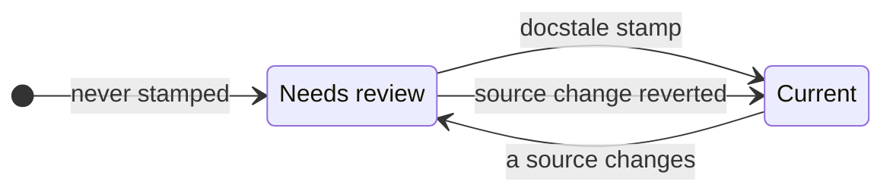

# Docstale reference

Checked on: 2026-10-22.

This page describes every setting and behavior. To set docstale up, start with
the [README](../README.md).

## Configure documents

Each key in `[documents]` names a document, and its value lists the source
patterns that may affect it.

### Source patterns

Source patterns are relative to the repository root and are case sensitive.

- `pyproject.toml` matches one root file.
- `src/` matches every file under the root `src` directory.
- `src/*.py` matches Python files directly inside `src`.
- `**/*.py` matches Python files at any depth.

Every pattern is anchored to the repository root. For example, `src/` does not
match `vendor/src/`. Use an explicit `**/` prefix when a pattern should match at
any depth.

A directory pattern without glob characters, such as `vendor/lib/`, also
matches a submodule or symlink at that path. A submodule counts as changed when
its commit changes, not when files inside it are edited. This also applies when
`{dir}` supplies a directory name with spaces or literal glob characters.

Source matches always exclude the document itself and the root `docstale.lock`.
This exclusion also applies to broad patterns such as `**` and explicit
`docstale.lock` sources. Writing a stamp therefore cannot invalidate itself.

### Shared source lists

A `[sets]` table names a source list once so that several documents can include
it. A source written as `@name` inserts the set with that name.

```toml
[sets]
build = ["pixi.toml", "pyproject.toml"]

[documents]
"README.md" = ["@build", "src/"]
"docs/development.md" = ["@build", "scripts/"]
```

Set names use lowercase letters, digits, `-`, and `_`. A set cannot include
another set. Write `./@name` for a root path that starts with `@`.

### Document globs and directory templates

A key that contains `*`, `?`, or `[` is a glob. It names every matching file
that Git tracks, plus untracked files that Git does not ignore. Files created
later are included automatically, and each result is still a concrete document.
A source that starts with `{dir}` is relative to the directory of each document.

```toml
[documents]
"packages/*/README.md" = ["{dir}/"]
"packages/*/docs/architecture.md" = ["{dir}/../src/"]
```

Each package README watches its own package, and each architecture document
watches the `src` directory beside its `docs` directory. A template cannot climb
above the repository root.

When several keys name the same document, the document watches the sources of
all of them. An exact key can therefore add sources to a document that a glob
already covers.

## Check and stamp documents

```bash
docstale check
docstale stamp README.md
docstale stamp README.md docs/api.md
docstale stamp --all
```

`check` compares each document's current fingerprint with the lock. A document
needs review when its sources have changed since it was stamped, or when it was
never stamped. The command always prints a result. It exits `0` when no document
needs review, `2` when review is required, and `1` for configuration or Git
errors.

`check` also checks the configuration. It fails when an exact document does
not exist or a glob key matches no document. Sources that match no file and sets
that no document uses produce warnings on stderr without changing the exit
code. A shared configuration can therefore refer to files that exist only on
another branch. Dependency cycles and lock entries for documents no longer
configured also produce `docstale warning:` messages. Warnings do not change
JSON output or the exit code.

After you review a document, and update it if needed, record the review with
`docstale stamp` and one or more repository-relative document paths. Editing a
document does not record a review. `stamp --all` stamps every document, which is
how a repository starts using the lock. Every stamp also drops entries for
documents that are no longer configured.

A path that is not a configured document causes an error before any stamp.
If configured documents watch that path as a source, the error names those
documents.

A fingerprint covers the Git object id of every file that the document's sources
match, except the document itself and the root `docstale.lock`. It is the same
on every clone and platform. Reverting a source change makes the document
current again.

### Review order

When one document watches another document, docstale lists the upstream document
first. Review and update upstream documents before their downstream documents.
An upstream document edit can make a downstream document need review.

Docstale groups dependency cycles into strongly connected components. It orders
these groups by their dependency graph. It uses path order within each cycle
and to choose between groups with no remaining upstream dependency. Cycles
produce warnings, not errors. A document that matches itself does not form a
cycle because source matches exclude the document itself.

### Lock and report



Entries in `docstale.lock` are separated by blank lines, so stamps of different
documents merge cleanly. When a merge leaves an entry in conflict, `check`
reports that document and `stamp` rewrites the file.

Use `--json` for scripts:

```json
{
  "documents": [
    {
      "path": "README.md",
      "since": "9c1b2e7d41f0a3c2b5e8d6f4a1c0b9e8d7f6a5c4",
      "sources": ["src/client.py"],
      "stamped": true
    }
  ],
  "status": "review_required"
}
```

`since` is the commit that recorded the lock fingerprint. If the working
stamp has no matching history, docstale uses the committed stamp from
`HEAD:docstale.lock` to find that commit. If that entry or its history is absent,
docstale uses `HEAD`. Before the first commit, `since` is `null`.

`sources` lists the matched files that changed since that commit. Untracked
files also appear in this list. They do not appear in
`git diff <commit> -- <source>`, so read them directly.

A stamped document can need review with an empty `sources` list. Source patterns
can add or remove unchanged files, or a shallow clone can lack the required
history. The text report explains this case without a `changed since` heading.
Read the document and its configured sources directly. The JSON fields stay the
same. A document that was never stamped has `stamped` set to `false`, `since`
set to `null`, and no sources.

## Agent hook

The hook stays silent outside a Git repository, when no `docstale.toml` exists,
or when no review is needed. Outside a Git repository, it creates no state and
does not request a continuation. Manual commands still report an error there.

A broken configuration or Git failure returns a continuation message at Stop
so the agent can report or fix it. SessionStart failures are reported on stderr
without blocking the session. An invalid Git directory target, a broken Git
configuration, and a missing Git executable remain errors.

SessionStart saves a baseline with the fingerprint of every document. At Stop,
the hook asks for a review of each document whose fingerprint differs from both
the lock and the baseline:

| At SessionStart | During the session | Reminder at Stop |
| --- | --- | --- |
| Current | A source changes | Yes |
| Needs review | No source changes | No, `docstale check` still lists it |
| Needs review | A source changes again | Yes |
| Either | The sources return to their starting or stamped state | No |

A read-only request gets no reminder if its matched sources stay unchanged.
Docstale observes repository state, not which actor changed a file. The reminder
lists changed sources when Git history permits. Stamping the document clears
it. The baseline is preserved when the same session resumes or compacts.

A reminder does not grant permission to edit files. If the current user request
requires a read-only response or prohibits edits, the agent must only report
the affected documents. It must not edit files or run `docstale stamp`.

Changes made by you or other tools in the same checkout during the session also
count, and so does a configuration change that changes a document's matched
files. Committing session edits does not hide them from the hook. Staging or
committing existing edits alone does not trigger a reminder.

If a baseline is missing, corrupt, or from an unsupported version, the hook
saves the current fingerprints and stays silent. With only Stop configured, the
first Stop establishes the baseline, and only later edits can trigger a
reminder.

The agent protocol marks a continuation with `stop_hook_active`. Docstale lets
that continuation stop without running another check. It also remembers the
fingerprint at which it last reported each document in a session, so a document
is reported again only after its sources change again. The hook saves
acknowledgements only after it builds the review entries. A Git failure during
that step preserves earlier acknowledgements.

Baselines and acknowledgements live separately under
`git rev-parse --git-path docstale`. They contain document fingerprints, not
file contents. Clearing an acknowledgement preserves the baseline. No state file
enters the working tree, and linked worktrees have separate state.

To switch the hook off or on for the current checkout only, run
`docstale disable` or `docstale enable`. Manual `check` and `stamp` commands
still run while the hook is disabled. The switch is stored beside the hook state
under Git metadata.

### Pi adapter

The pi extension translates lifecycle events into the same `docstale hook`
protocol. It does not implement a separate check.

| Pi event | Hook action |
| --- | --- |
| `session_start` | Send `SessionStart` with pi's current session ID and working directory. |
| `agent_before_settle` | Send `Stop` after the request's automatic retries and queued work finish. |
| A `block` response | Append the reason as a visible custom message. Request one model continuation. |
| `agent_settled` | Allow a reminder in the next request. |
| `session_shutdown` | Cancel any pending hook process. |

The adapter prefixes session IDs with `pi:` to separate pi state from other
agents' state. Pi reminders omit the `docstale-reviewer` subagent instructions.
Python selects the reminder text from the session prefix. Resume and reload use
the existing session ID and preserve its baseline. Compaction and tree navigation
do not capture another baseline. New sessions and forks use their own session
IDs and baselines.

The adapter skips the check during its review continuation. It does not check or
request a continuation when pi reports an aborted or failed run. If another
extension already requests a continuation, docstale waits for the next settlement
boundary. The adapter preserves entries that earlier extensions supplied.

The extension works in interactive, RPC, JSON, and print modes. Startup failures
produce a warning, not a model request. Interactive and RPC sessions receive UI
notifications. Print and JSON sessions receive diagnostics on stderr, never
stdout. Stop failures produce one continuation message, as they do in the shared
hook protocol.

The adapter runs `docstale hook` without a shell. Each invocation has a
30-second timeout and a 1 MiB limit for each output stream. A missing executable,
failed process, timeout, output overflow, or malformed response follows the same
startup and Stop error rules.

The default executable is `docstale` from `PATH`. Set `DOCSTALE_EXECUTABLE` to
an executable path to use another installation. The adapter always passes
`hook` as its only argument. It does not accept a shell command or an argument
list in this variable.

See the [README](../README.md#pi) for setup. The extension targets pi 1.0.2 or
newer, which provides the actionable `agent_before_settle` event.

## Reviewer subagent

Claude Code and Codex reminders suggest a `docstale-reviewer` subagent when
available. Pi reminders do not suggest this subagent. The subagent reads the
source diff and the document and reports whether the document needs an update. It does not edit files or stamp documents, so the
main agent stays responsible for both. Without the subagent, the main agent
reviews each document itself. Read-only user requests prohibit edits and stamps
in both cases.

When the user permits edits, the main agent stamps `unaffected` documents.
It updates and then stamps `affected` documents. It asks you about `unsure`
documents. A small model keeps each review cheap. Every stamp stays visible in
the `docstale.lock` diff.

### Reviewer model

Docstale does not select or run models. Configure the reviewer in the coding
agent's native definition:

| Agent | Project file | Shipped model | Reasoning effort |
| --- | --- | --- | --- |
| Claude Code | `.claude/agents/docstale-reviewer.md` | `haiku` | Host default |
| Codex | `.codex/agents/docstale-reviewer.toml` | `gpt-6-luna` | `high` |

Edit `model` in the reviewer file to choose another model. For Codex, also set
`model_reasoning_effort` to a value the selected model supports. The model must
be available to your account. Restart Codex after changing the definition.

Codex applies these values to the named reviewer, not the main agent or other
subagents. Omitted settings follow Codex's normal subagent inheritance rules,
which can retain the parent's reasoning effort even when the reviewer selects
another model. Set both values explicitly to avoid that mismatch. See
[Codex's subagent guide](https://developers.openai.com/codex/subagents#custom-agents)
for configuration precedence and native agent-file support.

The Codex definition requests a read-only sandbox. Runtime permission overrides
can supersede that default. The review instructions still prohibit edits and
stamps. Pi does not start a reviewer subagent, so these files do not change pi's
model selection.

See the [README](../README.md#claude-code-and-codex) for reviewer installation.

## Pre-commit and CI

The `docstale` pre-commit hook runs `docstale check`, which blocks a commit
while a document needs review or the configuration is invalid. It does not
receive changed filenames.

Pre-commit sets unstaged changes aside while hooks run, so stage
`docstale.lock` with the rest of the commit. It also hides the warnings of a
passing hook unless the hook sets `verbose: true`.

In CI, a shallow checkout gives the right result. The report lists changed sources
only when the history includes the commit that recorded each stamp. Use
`fetch-depth: 0` if you want that list. With insufficient history, the text
report explains why no changed source paths are available.
